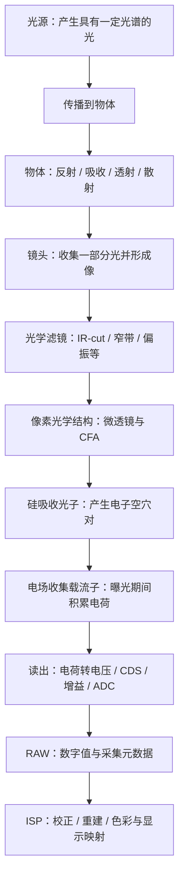

# 一个光子的旅行

> 从光源到 RAW：理解图像形成之前，光与传感器究竟发生了什么。

本章是 Photon2Pixel 的起点。我们沿着一条成像链路，理解光源如何发光、物体如何改变光谱和传播方向、镜头如何收集光，以及硅如何把光能转换为可测量的电荷。

“一个光子的旅行”是一条帮助理解的叙事线索。实际相机测量的是曝光时间内大量光子产生的电荷及其统计波动；光子在被吸收后就不再存在，后面的电子、电压和数字值是这次相互作用留下的信号。

读完本章，你应该能够：

- 区分光子能量、光功率、光子数量和图像亮度。
- 解释曝光、光圈、像元面积和 QE 如何影响有效信号。
- 理解电子空穴对、散粒噪声、读出噪声和 SNR。
- 把场景光经过相机变成 RAW 的过程写成一个有单位、有假设的模型。
- 判断成像问题应该优先检查照明、光学、传感器还是 ISP。

符号约定：正文用 `lambda_0`、`mu_e`、`sigma_r` 等名称表示公式中的对应变量。`lambda`、`nu`、`eta`、`mu`、`sigma` 分别对应希腊字母 λ、ν、η、μ、σ；下划线表示下标，`sqrt(...)` 表示平方根，`e-` 表示电子数单位，不是欧拉常数的运算表达式。

## 1. 为什么工业视觉工程师需要理解 Photon Physics？

我们常从 OpenCV、图像处理和深度学习开始学习视觉，但算法真正接收到的数据来自前端测量：

```text
照明与物体
    ↓
场景中的光
    ↓
镜头与滤光系统
    ↓
Sensor：光 → 电荷 → 数字值
    ↓
RAW → ISP → Image
    ↓
检测 / 分割 / 测量 / 决策
```

如果只观察最后的 RGB 图像，很容易把上游问题当成算法问题。

| 观察到的现象 | 应优先考虑的机制 |
| --- | --- |
| 增加曝光后检测更稳定 | 收集了更多光子，信号相对随机噪声变强；前提是没有饱和或明显运动模糊 |
| 提高增益后图像更亮，但细节没有变可靠 | 增益放大已有信号，通常也放大已有噪声，并没有增加入射光子 |
| 高像素相机没有带来更好的测量结果 | 镜头 MTF、像元采光量、采样、曝光和噪声可能限制了有效分辨率 |
| 夜间图像噪声大、模糊或偏色 | 光子不足、读出噪声、长曝光运动模糊、光源光谱和 IR 污染都可能参与 |

尤其要注意：“曝光增加后噪声降低”通常指**相对噪声降低、SNR 提高**，不是电子数单位下的噪声标准差一定变小。低照度也不意味着一定由 shot noise 主导；信号很弱时，read noise 可能更重要。

## 2. 先看完整旅行路线

下面以普通 Bayer 彩色 CMOS 相机为例。单色相机没有 Bayer CFA；不同传感器的光学堆叠和读出结构也会不同。



这条路线有三个关键转变：**场景信息被光携带，光能被转换为电荷，电荷被编码为数字值。** 每一步都有损失、噪声或采样限制。

## 3. 应该用哪一种模型理解光？

光线、波和光子是描述不同现象的模型，不是三种不同的光。

| 模型 | 描述方式 | 适合解释的问题 |
| --- | --- | --- |
| 几何光学 | Ray，光线及其传播方向 | 焦距、FOV、成像位置、光阑、工作距离 |
| 波动光学 / 电磁理论 | 电磁场的振幅、相位与偏振 | 干涉、衍射、偏振、反射和折射 |
| 量子描述 | 电磁场的量子化能量交换 | 光子能量、光探测、光子计数的统计波动 |
| 半导体物理 | 能带、载流子与电场 | 光吸收、电子空穴对、收集与复合 |

例如，估算视野时可以先用几何光学；解释小光圈为什么损失细节，需要波动光学；解释硅为什么产生电信号，需要量子和半导体模型。

经典电磁学将光描述为电磁波。对真空中的平面波，电场、磁场和传播方向彼此垂直。量子描述中，频率为 `nu` 的光以 `h × nu` 为单位交换能量。

不要把光子理解为具有确定经典轨迹的小球，也不要把 CMOS 理解为“把光子堆起来”。普通成像像素主要积累的是光子被吸收后产生并被收集的电荷。

## 4. 光源怎样产生光子？

### 4.1 能量从哪里来？

发光需要能量来源，但输入能量不会全部成为我们需要的光。

| 光源 | 主要机制 | 对成像的影响 |
| --- | --- | --- |
| LED | 电注入载流子，电子与空穴发生辐射复合 | 光谱与半导体材料、温度和驱动有关；白光 LED 常结合荧光粉 |
| 激光 | 在增益介质和反馈结构中通过受激辐射放大光 | 相干性强，粗糙表面成像可能出现 speckle（散斑） |
| 白炽灯 / 热辐射源 | 热运动相关的电磁辐射 | 通常具有宽光谱，光谱分布随温度变化 |
| 荧光材料 | 吸收能量后重新辐射 | 发射光谱与入射光谱不同，常有更长的发射波长 |

对一次离散的辐射跃迁，可以写成：

$$
\Delta E = E_{\mathrm{high}}-E_{\mathrm{low}} = h\nu,
\qquad
\lambda_0 = \frac{hc}{\Delta E}.
$$

这里 `lambda_0` 是真空波长。并非所有跃迁都会发光；能量也可能通过非辐射过程转为热。固体中的能带、展宽以及热辐射也不能简单等同于孤立原子的两条能级。

### 4.2 电功率不等于光功率

光源标注的电功率、辐射功率、流明，以及最终到达某个像素的功率是不同量。即使两盏灯电功率相同，光谱、效率、照明方向和目标上的辐照度也可能不同。

工业视觉中应关心：**有多少合适波段的光，在需要的时间内，经由目标和镜头到达传感器。**

## 5. 一个光子有多少能量？

$$
E_\gamma = h\nu = \frac{hc}{\lambda_0}
$$

其中：

- `h = 6.62607015 × 10^(-34) J·s`：普朗克常数。
- `c = 299792458 m/s`：真空光速。
- `nu`：频率，单位 Hz。
- `lambda_0`：真空波长，单位 m；在空气中通常可近似使用标称波长。
- `1 eV = 1.602176634 × 10^(-19) J`。

方便记忆的形式是：

$$
E_\gamma[\mathrm{eV}]\approx\frac{1240}{\lambda_0[\mathrm{nm}]}.
$$

| 光 | 波长 | 单个光子能量 |
| --- | --- | --- |
| 蓝光 | 450 nm | 约 2.76 eV |
| 绿光 | 550 nm | 约 2.25 eV |
| 红光 | 650 nm | 约 1.91 eV |
| 近红外 | 850 nm | 约 1.46 eV |

**波长越短，单个光子的能量越高；图像是否更亮，还取决于光子数量和整个系统的光谱响应。**

对于近似单色光，辐射功率 `P` 对应的平均光子流率为：

$$
\dot N_\gamma = \frac{P}{E_\gamma} = \frac{P\lambda_0}{hc}.
$$

因此在相同辐射功率下，650 nm 红光的光子数量是 450 nm 蓝光的 `650 / 450 ≈ 1.44` 倍。这个比较不等于相同电功率或相同照度，也不直接说明红光成像的 SNR 更高；目标反射率、镜头透过率和 QE 都需要一起计算。

## 6. 从“灯有多亮”到“像素收到多少光”

### 6.1 辐射度量与光度量

辐射度量描述光的物理能量；光度量还根据人眼的视觉敏感度进行加权。

| 量 | 含义 | 常用单位 |
| --- | --- | --- |
| 辐射通量 `Phi_e` | 总辐射功率 | W |
| 辐射强度 `I_e` | 单位立体角内的辐射功率 | W/sr |
| 辐照度 `E_e` | 单位受照面积接收到的辐射功率 | W/m² |
| 辐亮度 `L_e` | 单位投影面积、单位立体角内的辐射功率 | W/(m²·sr) |
| 光通量 | 经视觉敏感度加权的通量 | lm |
| 照度 | 单位面积接收的光通量 | lx |

这里的“辐射强度”有明确的立体角定义；日常说的“光强”可能指功率、照度或像素亮度，工程讨论时应明确单位。

相同 lux 下不同光谱的辐射功率可能不同，传感器产生的电子数也可能不同，尤其不能用人眼几乎看不见的近红外与可见光直接比较 lux。

### 6.2 场景与像面不是同一个位置

照到目标上的辐照度，经过反射和镜头收集后，才形成传感器像面上的辐照度。它们不能直接代入同一个像素光子公式。

对于理想 Lambertian 漫反射表面：

$$
L_{e,\lambda} = \frac{\rho(\lambda)E_{\mathrm{object},\lambda}}{\pi}.
$$

`rho(lambda)` 是光谱反射率。真实表面还可能具有方向相关的反射特性，需要用 BRDF 描述；金属、玻璃和抛光表面不能随意当成 Lambertian 表面。

### 6.3 一个像素的光子预算

若像面上近似单色、均匀且稳定的辐照度为 `E_e`，像素面积为 `A`，曝光时间为 `t`：

$$
\overline{N}_{\gamma}
=\frac{E_eAt}{E_\gamma}
=\frac{E_eAt\lambda_0}{hc}.
$$

单位检查：`W/m^2 × m^2 × s = J`，再除以每个光子的能量，就得到光子数量。

例如，550 nm 光、`E_e = 0.01 W/m^2`、`3.45 μm` 方形像元、`t = 10 ms`：

$$
A=(3.45\times10^{-6})^2
\approx1.19\times10^{-11}\ \mathrm{m^2},
$$

$$
E_\gamma\approx3.61\times10^{-19}\ \mathrm{J},
\qquad
\overline{N}_{\gamma}\approx3295.5.
$$

这是一次曝光的**期望光子数**，不是每次都会精确到达某个固定数量的光子。后面还要考虑转换效率和随机波动。

## 7. 光传播到物体后发生什么？

在均匀介质、几何光学近似下，可以把光看成沿直线传播。遇到材料界面时，可能发生反射、透射、吸收和散射；荧光等过程还可能改变光谱。

### 7.1 折射与反射

折射满足 Snell 定律：

$$
n_1\sin\theta_1=n_2\sin\theta_2.
$$

角度相对界面法线测量。光跨越静止界面时频率不变，介质中的波长和相速度改变；不能因为波长变短，就认为单个光子的能量增加了。能量公式 `h × c / lambda_0` 使用的是真空波长。

界面通常也会反射一部分光。AR coating（增透膜）利用干涉减少设计波段内的反射，但透过率仍与波长、入射角和偏振有关。

### 7.2 物体颜色来自选择性的光谱作用

同一物体在不同光源下可能呈现不同颜色，因为到达相机的光同时受到光源光谱、材料反射率和观察方向影响。常规弹性反射主要改变方向和强度，不是把每个白光光子“染成红色”。

对不发生波长转换的被动样品，在匹配的测量条件下，其总反射率、总透射率和吸收率满足：

$$
R(\lambda)+T(\lambda)+A_{\mathrm{abs}}(\lambda)=1.
$$

散射光应计入反射或透射的总量，避免重复计算。荧光等波长转换过程需要另外建立能量模型。

对工业视觉而言，选择照明波长和几何关系的目的，往往是增强缺陷与背景的**对比度**，而不只是把整幅图像照得更亮。

## 8. 镜头究竟做了什么？

镜头收集来自物点的一部分光，并使这些光在像面上形成对应的空间分布。理想点物体也不会产生无限小的像点：衍射、像差和离焦会共同决定点扩散函数 PSF。

薄透镜的近轴近似为：

$$
\frac{1}{f}=\frac{1}{u}+\frac{1}{v},
\qquad
|m|=\frac{v}{u}.
$$

`f` 为焦距，`u`、`v` 为物距和像距，`m` 为放大率。复杂镜头需要考虑主平面；上述关系用于建立直觉，不代替实际镜头参数。

### 8.1 光圈控制光通量，也影响成像质量

F-number 定义为：

$$
N=\frac{f}{D_{\mathrm{entrance\ pupil}}}.
$$

这里 `D` 是入瞳直径，不一定等于光阑的实体直径。在远距离、轴上、透过率近似不变等条件下，像面辐照度近似满足 `E_e ∝ 1/N^2`。从 f/4 开到 f/2.8，通常约增加一档曝光，即约两倍光量。近距离和高倍率成像应考虑 working / effective F-number，不能机械套用标称值。参见 [Edmund Optics：F-number 与光通量](https://www.edmundoptics.com/knowledge-center/application-notes/imaging/lens-iris-aperture-setting/)。

实际使用时还要权衡景深、像差、暗角和衍射。大光圈常增加采光，但可能暴露更强的像差；适度收光圈可能改善成像；继续收小则衍射影响增大。最佳光圈需要结合目标频率、视场位置和测量结果判断。

### 8.2 为什么很小的光圈会损失细节？

对于理想圆形孔径、近轴衍射受限成像，Airy disk 第一暗环对应的直径近似为：

$$
d_{\mathrm{Airy}}\approx2.44\lambda_0N.
$$

在 550 nm、f/8 下，`d ≈ 10.7 μm`，约为 3.45 μm 像元宽度的 3.1 倍。这说明一个物点的能量分布可以跨越多个像元；**不能直接把 Airy disk 直径当成可分辨缺陷尺寸**，实际还需看 MTF、对比度、放大率和采样。公式与适用背景参见 [Edmund Optics：Airy Disk 与衍射限制](https://www.edmundoptics.com/knowledge-center/application-notes/imaging/limitations-on-resolution-and-contrast-the-airy-disk/)。

## 9. 光到达硅之前，还要经过哪些结构？

普通彩色相机可能包含以下结构；实际层次和先后顺序取决于设计：

| 结构 | 作用 | 工程上应关注什么 |
| --- | --- | --- |
| IR-cut / 窄带滤镜 | 限制进入相机的光谱 | 透过曲线、截止区域、入射角影响 |
| 偏振片 | 选择偏振分量 | 可抑制某些反光，也会损失光量 |
| 保护玻璃 / 其他光学层 | 保护或实现特定光学功能 | 透过率、反射、污染、鬼影 |
| Microlens | 把光更有效地导向感光区域 | 入射角、像素结构、有效收集效率 |
| Color Filter Array | 对光谱进行分通道筛选 | 各通道响应、串扰、光量损失 |

### 9.1 为什么彩色相机常加 IR-cut？

硅在近红外仍可能有响应，而 Bayer 滤色片也未必完全阻挡近红外。人眼不可见的光参与 R/G/B 通道测量后，会改变相机的颜色响应。

IR-cut 用于限制这类污染。近红外工业检测可能故意使用不带 IR-cut 的相机或专用滤镜；是否需要截止近红外，取决于测量目标和标定条件。

### 9.2 Bayer CFA 如何得到颜色信息？

常见 RGGB 排列如下，每个格子是一个独立的物理像素：

```text
┌─────┬─────┐
│  R  │  G  │
├─────┼─────┤
│  G  │  B  │
└─────┴─────┘
```

单个 Bayer 像素只测得一个滤波通道的标量信号。Demosaicing 利用邻域信息估计该位置缺少的通道，而不是读出该像素本来就存在的三个 RGB 值。

实际 R/G/B 滤光曲线是有宽度并相互重叠的，不是只允许一种波长通过。两个绿色采样位置增加了绿色通道的空间采样密度，并不意味着四个像素构成一个只能输出一次的固定“超级像素”。

## 10. 为什么硅能把光转换为电荷？

### 10.1 光子被吸收后发生了什么？

在半导体的能带模型中，价带电子吸收足够能量后，可以跃迁到导带：

```text
导带：出现一个可参与导电的电子
           ↑ 吸收光子的能量
价带：留下一个空穴
```

这就是 electron-hole pair（电子空穴对）。空穴是价带中缺少一个电子所表现出的有效载流子，不是一个被光子打出的实体孔洞。电子并不是凭空产生，而是已有电子的状态改变。

室温下，硅带隙约为 `E_g ≈ 1.12 eV`，对应的波长尺度为：

$$
\lambda_g\approx\frac{1240}{1.12}\ \mathrm{nm}
\approx1107\ \mathrm{nm}.
$$

普通硅光电探测器的长波响应因此通常在约 1000–1100 nm 附近衰减。硅是间接带隙材料，实际吸收还与声子参与、吸收深度、厚度、温度和器件结构有关；带隙估算不是一条理想的矩形响应曲线。具体响应应查器件数据，参见 [Hamamatsu：Si Photodiodes](https://www.hamamatsu.com/content/dam/hamamatsu-photonics/sites/documents/99_SALES_LIBRARY/ssd/si_pd_kspd0001e.pdf)。

### 10.2 能量够了，不代表一定产生有效信号

光可能被反射、透过，或在不利于收集的位置被吸收。已产生的载流子也可能复合。光电二极管的电场帮助分离和收集载流子，像素在曝光期间积累相关电荷。

对于普通可见光成像、无内部倍增的模型，一次成功的光吸收通常产生一对电子空穴。高于带隙的剩余能量主要通过弛豫转为热；不能认为“蓝光能量更高，所以一个蓝光光子必然产生更多可测电子”。高能辐射和内部倍增器件需要不同模型。

### 10.3 Quantum Efficiency 是什么？

QE 描述入射光子产生并被收集为有效信号电子的效率。对指定波长：

$$
\eta(\lambda)=\frac{\overline{N}_e}{\overline{N}_{\gamma}},
\qquad
\overline{N}_e=\eta(\lambda)\overline{N}_{\gamma}.
$$

公式中的 `eta(lambda)` 是指定波长下的 QE；`N_e` 是有效信号电子数，`N_gamma` 是入射光子数，上方横线表示平均值或期望值。这里强调的是平均值或期望值，不是每次曝光都严格按比例得到整数电子数。

**使用 QE 前要明确参考面。** 裸硅的内部效率、像素表面的外部 QE 和整台相机测得的有效响应可能包含不同损失。若数据已经包含微透镜、填充率或 CFA 的影响，就不能再把同一项透过率乘一次。

### 10.4 普通像素为什么不能直接判断颜色？

光吸收后，普通像素输出的是累计电荷，不保留每个光子的波长标签。不同入射光谱经过同一响应函数积分后，可能得到相同电子数。

CFA、多光谱滤镜或分光结构通过多个不同的光谱测量通道提供额外信息；Bayer 通道仍需白平衡和色彩标定，不能直接等同于标准显示 RGB。

## 11. 从电子到 RAW 数字值

以常见 4T pinned-photodiode CMOS 像素为例：

```text
曝光期间积累电荷
    ↓ Transfer Gate
电荷转移到 Floating Diffusion（FD）
    ↓ 电荷转电压
像素 / 列读出与 CDS
    ↓ 增益与 ADC
Digital Number（DN）
```

电子数对应的电荷量大小为：

$$
|Q|=N_e q,\qquad q=1.602176634\times10^{-19}\ \mathrm{C}.
$$

对简化的 FD 电容模型：

$$
|\Delta V|\approx\frac{N_e q}{C_{\mathrm{FD}}}.
$$

`C_FD` 影响 charge-to-voltage conversion gain。CDS（Correlated Double Sampling）通过相关的复位和信号采样抑制部分噪声与偏置，但不会消除所有读出噪声。具体电路顺序取决于传感器架构。

对固定采集配置，在未饱和、近似线性的工作区，可以用概念模型表示：

$$
\mathrm{DN}=\operatorname{clip}\left(
\operatorname{round}\left[B+K(N_e+N_d)+n_{\mathrm{DN}}\right],
0,2^b-1\right).
$$

- `B`：黑电平偏置，单位 DN。
- `K`：该配置下的有效增益，单位 DN/e-。
- `N_d`：曝光期间积累的暗电流电子数。
- `n_DN`：折算到输出端的读出等扰动；完整统计模型需避免重复计入噪声。
- `b`：输出有效位深。

这里用 clip 表示数字编码边界，**不代表所有饱和都发生在 ADC**；光电二极管满阱、FD 容量和模拟链路也可能先达到上限。

### 11.1 黑电平与位深

无光时 RAW 不一定为零：偏置便于保留噪声围绕基准的波动，暗电流也会贡献信号。黑电平校正通常发生在数字处理阶段，偏置本身可能来自模拟或数字链路；不能把“Black Level”固定理解为 ADC 后的一块物理器件。

| 有效位深 | 理论编码范围 |
| --- | --- |
| RAW10 | 0–1023 |
| RAW12 | 0–4095 |
| RAW14 | 0–16383 |

实际黑电平、白电平和有效范围需要查相机配置及元数据。RAW12 也可能被 packed 保存，或放入 16-bit 容器；容器大小不等于有效位深。

更多位数表示更细的数字编码，不自动意味着更低噪声或更高动态范围。RAW 也可能已经经过传感器内部校正，不能仅凭文件名判断它完全未经处理。

## 12. 噪声与 SNR：为什么多收集光子有用？

### 12.1 Photon Shot Noise

对于常规成像中的近似独立到达事件，常用 Poisson 模型描述光子计数。更一般的光场可能有不同统计特性，这里采用普通相机的基础模型。

经过独立探测后，信号电子数也可近似写成：

$$
N_e\sim\operatorname{Poisson}(\mu_e),
\qquad
\operatorname{Var}(N_e)=\mu_e,
\qquad
\sigma_{\mathrm{shot}}=\sqrt{\mu_e}.
$$

曝光翻倍时，平均信号翻倍，shot noise 的标准差只增加到原来的 `sqrt(2)` 倍，因此相对波动更小。

### 12.2 不能忽略其他噪声

| 项目 | 来源 | 常见表现 |
| --- | --- | --- |
| Shot noise | 光生载流子数量的随机波动 | 方差随平均信号增大 |
| Read noise | 复位、放大、读出及相关电路 | 弱信号下可能限制探测能力 |
| Dark-current shot noise | 暗电流载流子的随机产生 | 与温度、曝光时间相关 |
| Quantization noise | ADC 的有限量化步长 | 取决于输入折算步长 |
| DSNU / PRNU | 像素间暗信号 / 响应不均匀 | 空间上的固定差异，需与时间噪声区分 |

在噪声独立、已去除平均偏置的简化模型中，用电子数作为共同单位：

$$
\sigma_{\mathrm{total}}^2
\approx\mu_e+\mu_d+\sigma_r^2+\sigma_q^2,
\qquad
\mathrm{SNR}=\frac{\mu_e}{\sqrt{\mu_e+\mu_d+\sigma_r^2+\sigma_q^2}}.
$$

| 符号 | 含义 | 单位 |
| --- | --- | --- |
| `N_e` | 一次曝光中实际得到的随机信号电子数 | e- |
| `mu_e` | 信号电子数的期望值 | e- |
| `mu_d` | 暗电流电子数的期望值 | e- |
| `sigma_shot` | 光生散粒噪声的标准差 | e- RMS |
| `sigma_r` | 输入折算读出噪声的标准差 | e- RMS |
| `sigma_q` | 输入折算量化噪声的标准差 | e- RMS |
| `sigma_total` | 合成时间噪声的标准差 | e- RMS |
| `Delta_e` | 每个量化步长（LSB）对应的电子数 | e-/LSB |
| `SNR` | 平均信号与噪声标准差之比 | 无量纲 |

`mu_d` 是平均暗电子数，`sigma_r` 是输入折算读出噪声。若给定的读出噪声已包含量化贡献，应避免重复相加。理想均匀量化误差条件下，`sigma_q ≈ Delta_e / sqrt(12)`，其中 `Delta_e` 是每个 LSB 对应的电子数；极弱信号下不能无条件使用均匀误差假设。

Shot-noise-limited 时，`SNR ≈ sqrt(mu_e)`；read-noise-limited 时，`SNR ≈ mu_e / sigma_r`。这里只分析时间随机噪声，固定空间误差和场景对比度仍会影响实际测量。

这些线性信号与噪声概念可进一步对照 [EMVA 1288 Release 4.0 Linear](https://www.emva.org/wp-content/uploads/EMVA1288Linear_4.0Release.pdf)，正式相机表征应按其测量定义执行。

### 12.3 一个数值例子

假设读出噪声为 3 e- RMS，忽略暗电流、量化与空间不均匀性：

| 平均信号 `mu_e` | Shot noise | 总噪声 RMS | SNR | 相对总噪声 |
| --- | --- | --- | --- | --- |
| 100 e- | 10 e- | 约 10.44 e- | 约 9.58 | 约 10.4% |
| 400 e- | 20 e- | 约 20.22 e- | 约 19.78 | 约 5.1% |

信号变为四倍，总噪声绝对值增大，但相对噪声大约减半。这才是“更多曝光使图像更干净”的物理含义。若用分贝表示上述幅度比，`SNR_dB = 20 × log10(SNR)`。

### 12.4 为什么增益不能替代曝光？

数字增益将已有信号与噪声一起放大，通常不改善输入端 SNR，还可能引入裁剪。模拟增益也不会创造光生电子，但可以改变后级噪声和量化误差的相对影响。某些传感器的 conversion gain 模式还会改变读出噪声与饱和容量，需要具体分析。

延长曝光、增加照明或增加有效采光才能增加光生电子，但都存在边界：运动模糊、闪烁、发热、景深、反光或饱和。

## 13. 满阱、动态范围与像元大小

Full Well Capacity（FWC）描述像素可容纳的电荷量尺度。可用的饱和信号还受读出模式、模拟链路与 ADC 限制，不能始终与 FWC 等同。

对于简化线性模型，使用输入折算的可用饱和信号 `N_sat` 和噪声下限 `sigma_floor`，动态范围可粗略估计为：

$$
\mathrm{DR}_{\mathrm{dB}}\approx20\log_{10}\left(\frac{N_{\mathrm{sat}}}{\sigma_{\mathrm{floor}}}\right).
$$

例如 `N_sat = 10000 e-`、`sigma_floor = 3 e-`，得到约 70.5 dB。这是帮助理解的估算，正式指标应说明测量定义和配置；图像经过 tone mapping 变得“看起来细节更多”，也不等于传感器原生动态范围增加。

同样像面辐照度、曝光和有效 QE 下，较大像元因为面积较大，通常收集更多光子。但高像素数也可能改善空间采样；在相同输出尺度下进行合理合并或降采样后，比较结果又会变化。

比较相机时应统一 FOV、光学倍率、曝光、照明、输出尺度与带宽，并结合 QE、读出噪声、可用饱和容量和镜头 MTF。不能单凭“800 万 vs 200 万”或“像元更大”决定哪台更适合。

## 14. 把整条链路写成一个模型

### 14.1 光谱积分模型

设 `E_sensor,lambda(x, y, tau)` 为选定传感器参考面上的光谱辐照度，单位 W/(m²·m)，波长按 m 积分。令 `eta_eff,c(lambda, x, y)` 为从这个参考面到有效信号电子的通道响应，则：

$$
\mu_{e,c}(x,y)=
\int_0^{t_{\mathrm{exp}}}\int_{A_{\mathrm{pixel}}}\int
E_{\mathrm{sensor},\lambda}(x,y,\tau)
\frac{\lambda_0}{hc}
\eta_{\mathrm{eff},c}(\lambda,x,y)
\,d\lambda\,dA\,d\tau.
$$

| 符号 | 含义 | 单位或说明 |
| --- | --- | --- |
| `x, y` | 像面空间坐标 | 与面积积分使用的坐标单位一致 |
| `tau` | 曝光期间的时间积分变量 | s |
| `t_exp` | 曝光时间 | s |
| `A_pixel` | 单个像素对应的积分区域 | 面积单位 m² |
| `lambda` / `lambda_0` | 光谱积分变量 / 真空波长 | 本式均按 m 使用；空气中近似相等 |
| `E_sensor,lambda` | 选定参考面的光谱辐照度 | W/(m²·m) |
| `eta_eff,c` | 从参考面到信号电子的有效通道响应 | 无量纲 |
| `mu_e,c` | 通道 c 的期望信号电子数 | e- |
| 下标 `c` | 光谱通道编号，例如 R、G、B | 与光速常数 c 按所在位置区分 |

如果光谱辐照度使用 W/(m²·nm)，积分也必须使用 nm，并在光子能量计算中转换波长单位。参考面之前的镜头、滤镜损失包含在 `E_sensor,lambda` 中，之后的光学与转换损失包含在 `eta_eff,c` 中，避免双重计数。

均匀、稳定、单色条件下，这个模型简化为：

$$
\mu_e=\eta_{\mathrm{eff}}\frac{E_eAt\lambda_0}{hc}.
$$

### 14.2 把前面的光子预算算到 RAW

继续采用第 6 节的假设，并增加以下**教学参数，不代表任何具体相机**：

| 参数 | 假设值 |
| --- | --- |
| 相同参考面的有效 QE | 60% |
| 输入折算读出噪声 | 3 e- RMS |
| 增益 `K` | 0.2 DN/e- |
| 黑电平 `B` | 64 DN |
| 输出位深 | 12 bit |

忽略暗电流及额外噪声，且假设工作在线性区：

$$
\mu_e\approx3295.5\times0.6\approx1977\ \mathrm{e}^{-},
$$

$$
\sigma_{\mathrm{shot}}\approx44.5\ \mathrm{e}^{-},
\qquad
\mathrm{SNR}\approx\frac{1977}{\sqrt{1977+9}}\approx44.4,
$$

$$
\overline{\mathrm{DN}}\approx64+0.2\times1977\approx459.
$$

平均数字值约为 459，但每次曝光会有波动。只修改数字增益，会改变输出 DN，而不会改变之前已经收集到的约 1977 个平均信号电子。

```text
光源光谱 + 物体反射 / 透射特性
                   ↓
场景辐亮度 + 观察方向
                   ↓ 镜头收集、透过、PSF
像面光谱辐照度
                   ↓ 曝光时间 × 像素面积
期望光子数
                   ↓ 与参考面一致的有效 QE
期望光生电子数 + 随机波动
                   ↓ 电荷容量、读出噪声、增益、量化
RAW 数字值
                   ↓ ISP 的校正与重建
显示图像 / 算法输入
```

## 15. 用三个小实验验证直觉

以下实验优先使用线性 RAW，固定光源、光圈、增益和温度，关闭自动曝光与会改变统计量的处理。彩色 Bayer 数据应按同一 CFA 通道分别统计，避开饱和、坏点、明显渐晕和目标边缘。

### 实验一：曝光与相对噪声

拍摄静止、均匀的目标，每个曝光设置采集多帧，并取得匹配条件的暗场。先检查扣除暗场后的平均信号是否近似随曝光线性增加，再比较同一像素或 ROI 的时间波动。

预期在线性且无饱和条件下，平均信号增加，时间噪声的绝对值未必下降，但相对噪声一般下降。若偏离预期，检查光源闪烁、暗电流、自动控制、隐藏 ISP 或统计方法。

不要直接把单帧 ROI 的空间标准差视为 read noise，它还包含目标纹理和固定不均匀性。对相同条件的两帧 `I_1、I_2`，在独立、同分布且场景稳定的假设下，可以用：

$$
\sigma_{\mathrm{temporal}}^2\approx\frac{\operatorname{Var}(I_1-I_2)}{2}.
$$

差分有助于消除稳定的空间结构，多组帧可以提高估计可靠性。

### 实验二：曝光与数字增益

比较“较短曝光”“相同曝光后乘数字增益”和“更长曝光获得真实额外信号”。将结果统一到相同平均亮度，再比较细节与时间噪声。

数字增益应主要改变显示尺度；更长曝光通常改善 SNR，但移动目标上可能产生模糊。不要让自动 tone mapping 或降噪掩盖差异。

### 实验三：光圈与细节

固定焦点和静止测试目标，逐步改变光圈，调整曝光使平均信号大致一致，记录中心和边缘的细节对比度。

结果可能体现大光圈像差、中间光圈改善以及小光圈衍射；也可能受镜头设计、波长、离焦和采样限制。用测量选择工作光圈，避免从一张图直接推导普遍结论。

## 16. 从本章走向后续 ISP 学习

本章建立的是光与测量之间的联系，后续可以沿项目路线继续学习：

| 后续模块 | 要进一步回答的问题 |
| --- | --- |
| 02 CMOS Image Sensor | 像素、曝光方式、读出和 conversion gain 如何实现？ |
| 03 RAW Image | 黑电平、白电平、有效位深、packed 格式和元数据如何解释？ |
| 04 Bayer CFA | 空间采样、通道布局和混叠如何影响颜色重建？ |
| 05 ISP Pipeline | 哪些校正在线性域完成，哪些处理改变图像统计量？ |
| 06 / 07 / 08 AE / AWB / AF | 控制系统如何调节曝光、颜色与焦点？ |
| 09 / 14 / 15 HDR / Computational Photography / AI ISP | 如何利用多次测量、先验和学习方法得到更好的结果？ |

算法可以利用先验推断、融合多帧或改善显示，但可靠测量仍离不开光子预算、光学分辨率和传感器噪声。遇到不稳定结果时，应沿整条链路查找证据。

## 参考资料

- [EMVA 1288 Release 4.0 Linear](https://www.emva.org/wp-content/uploads/EMVA1288Linear_4.0Release.pdf)：相机线性响应、QE、时间噪声与 SNR 的测量框架。
- [Hamamatsu — Si Photodiodes](https://www.hamamatsu.com/content/dam/hamamatsu-photonics/sites/documents/99_SALES_LIBRARY/ssd/si_pd_kspd0001e.pdf)：硅光电二极管结构与光谱响应资料。
- [Edmund Optics — System Throughput, f/#, and Numerical Aperture](https://www.edmundoptics.com/knowledge-center/application-notes/imaging/lens-iris-aperture-setting/)：入瞳、F-number 与光通量。
- [Edmund Optics — The Airy Disk and Diffraction Limit](https://www.edmundoptics.com/knowledge-center/application-notes/imaging/limitations-on-resolution-and-contrast-the-airy-disk/)：圆孔衍射与像点尺寸。

本文公式用于建立基础工程模型；涉及具体相机时，请以器件数据、采集配置与实测结果替换示例假设。
