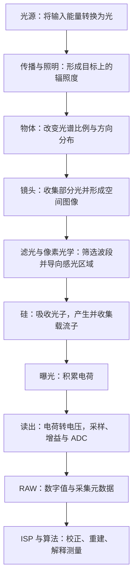

# 一个光子的旅行

> 沿着光源、物体、镜头、硅和读出电路，理解场景如何成为 RAW 图像。

Photon2Pixel 从成像的物理输入开始。图像中的亮度、颜色、细节和噪声，来自照明、材料、光学、传感器与处理链路的共同作用。理解这条链路，才能判断问题应该从哪里查起。

“一个光子的旅行”是一条叙事线索。实际相机测量的是曝光期间大量光子产生的累计电荷及其统计波动；一个光子被吸收后就不再继续存在，后面的电子、电压和数字值是相互作用留下的信号。

本篇先保持旅行路线连续，回答每一步的输入、作用和输出。概念详解、推导、读图方法、计算例子与实验整理在[《一个光子的旅行：附文》](01_一个光子的旅行_附.md)。

## 1. 先建立整条链路

这条链路包含三个核心转变：光携带场景信息，光与硅的相互作用形成电荷，电荷被编码为数字值。每一步都可能限制最后得到的信息。

沿着这条链路，我们将依次追问：光怎样产生并到达物体？物体返回的光怎样被镜头收集并形成图像？到达硅的光怎样留下电荷，又怎样成为 RAW 数字值？回答这些问题后，再看各环节怎样共同影响图像的亮度、颜色、细节和噪声。

阅读中涉及的光学模型与基本概念，可按需查阅[附文 A1：光的模型与基本概念](01_一个光子的旅行_附.md#models)。

## 2. 第一站：光源把能量转换为光

光源需要能量输入。LED 通过电注入载流子并发生辐射复合发光；激光利用受激辐射、增益和反馈产生输出；热辐射源的光谱与温度和发射率有关；荧光材料吸收激发光后重新发射光。

输入能量并不全部成为有用的出射光，非辐射过程、热和器件内部损失都会参与。光源输出还具有光谱、方向、空间分布和时间波形，所以灯的电功率不能直接代表目标收到的光量。

单个光子的能量由频率决定：

$$
E_\gamma=h\nu=\frac{hc}{\lambda_0}.
$$

ν 是频率，λ₀ 是真空波长，h 是普朗克常数，c 是真空光速。波长越短，单个光子能量越高；在相同辐射功率下，光子数量却可能更少。因此“更高光子能量”“更多光子”和“图像更亮”是不同问题。

光源光谱描述各波长上分配了多少能量。同样色温的白光也可能有不同光谱，后面经过材料和相机响应后，得到不同颜色和缺陷对比度。

这一站的输出是具有特定光谱、方向和时间分布的光。详见[附文 A2：光源与光谱](01_一个光子的旅行_附.md#sources)、[A3：光子能量与光子流率](01_一个光子的旅行_附.md#energy)。

## 3. 第二站：光传播到目标，形成照明

光源发出的光只有一部分到达目标。距离、方向、发光面积、照明光学和遮挡，共同决定目标各处接收到的光。

这里最直接的量是辐照度，即单位面积接收到的辐射功率，常用 W/m²。若还要描述波长组成，就使用光谱辐照度。它与按人眼敏感度加权的 lux 不是同一个量；相同 lux 不保证相同光子输入或相同相机信号。

光的时间分布也重要。相机积分的是有效曝光窗口中的光；频闪、PWM 或照明漂移会改变不同曝光收到的能量。Rolling shutter 不同行的窗口存在时间偏移，还可能形成亮暗条带。

这一站的输出是目标表面随位置、波长和时间变化的辐照度。它仍不是传感器像面上的辐照度，中间还要经过物体和镜头。详见[附文 A4：辐射度量与光子预算](01_一个光子的旅行_附.md#radiometry)。

## 4. 第三站：物体改变光的光谱比例与传播方向

光到达材料后，可以被反射、透射或吸收，也可能在表面和内部发生散射。反射或透射的光把材料、表面和几何结构的信息带向相机。

常规弹性反射通常保留光的频率，但不同波长被不同程度地返回，改变了出射光谱的比例。红色材料在白光下返回较多红光，不代表它能把任意蓝光光子直接“染成红色”。荧光则属于吸收后重新发射的过程，需要另外考虑波长转换。

方向也会变化。镜面反射可能集中在很窄的方向范围；粗糙表面和体散射可能让光分布到更多方向。总反射率较高，不保证朝镜头方向很亮。工业照明利用这些方向差异，让划伤、边缘或材料变化相对背景显现。

对理想 Lambertian 漫反射、无自发光和波长转换的表面：

$$
L_{\mathrm{object},\lambda}
=\frac{\rho(\lambda)E_{\mathrm{object},\lambda}}{\pi}.
$$

ρ(λ) 是光谱反射率，Eobject,λ 是目标上的光谱辐照度，Lobject,λ 是出射光谱辐亮度。真实材料还可能具有方向相关响应，需要更完整的反射模型。

这一站的输出是从场景不同位置、向不同方向传播的光谱辐亮度。详见[附文 A5：物体的光谱与方向响应](01_一个光子的旅行_附.md#scene)。

## 5. 第四站：镜头收集部分光，把场景映射到像面

镜头入瞳只占目标返回光的一部分方向范围，因此不会收集全部光。进入镜头的光还会受到反射、吸收、遮挡和透过率的影响。

镜头同时完成空间成像：来自同一物点的不同方向光在像面附近形成对应分布，不同物点对应不同位置。焦距、物距、像距和传感器尺寸决定成像几何；工作距离、对焦位置与实际镜头结构需要明确区分。

物点不会形成无限小的像点。衍射、像差和离焦决定 PSF；MTF 则描述不同空间频率的对比度能被保留多少。高像素数不能保证镜头已经传递了相应的细节。

光圈影响收光和空间质量。开大通常增加采光，但可能暴露更强像差；适度收小可能改善像差并增加景深；收得过小，衍射会使光斑展宽并降低高频对比度。

对轴上、空气中、近轴、无渐晕且适合使用 working F-number 的简化模型：

$$
E_{\mathrm{image},\lambda}
\approx\tau_{\mathrm{lens}}(\lambda)
L_{\mathrm{object},\lambda}\frac{\pi}{4N_{\mathrm{work}}^2}.
$$

τlens(λ) 是镜头光谱透过率，Nwork 描述当前成像条件的有效光锥。离轴、有限倍率和真实镜头设计需要相应修正。

这一站的输出是像面上的空间光分布与光谱辐照度。详见[附文 A6：镜头、衍射、PSF 与 MTF](01_一个光子的旅行_附.md#optics)。

## 6. 第五站：滤光与像素光学筛选进入硅的光

光在进入感光硅之前，可能经过保护玻璃、IR-cut、窄带滤镜、偏振片、微透镜和 CFA。具体结构与顺序取决于设计。

滤镜选择波段或偏振，也会损失部分光量。微透镜把光更有效地导向感光区域；Bayer CFA 让不同位置测量不同的光谱通道。每个 Bayer 像素仍只输出一个通道的标量信号，缺少的颜色信息由后续重建估计。

IR 污染需要按任务定义：若目标是可见光颜色测量，非目标近红外进入硅并贡献电荷，就可能改变颜色、材料对比度、曝光统计或焦点表现。若任务本来就是近红外检测，这些光可以是有用信号。

R/G/B 通道可能同时受到近红外影响。它们积累的电荷没有保留波长标签，白平衡不能普遍分离未知的可见光与近红外贡献；必要时应从光谱和光学滤波控制输入。

这一站的输出是经过像素光学结构筛选、到达感光区域的光。计算时必须选定参考面：如果外部 QE 已包含这些损失，就不能再次乘同一项透过率。详见[附文 A7：滤光、Bayer 与 IR 污染](01_一个光子的旅行_附.md#filters)。

## 7. 第六站：硅吸收光子，产生并收集载流子

光子在硅中被有效吸收后，可以将价带电子激发到导带，留下一个空穴，形成电子空穴对。电子不是凭空出现，而是已有电子的能态发生改变；空穴是电子缺位所表现出的有效载流子。

普通可见光、无内部倍增的模型中，一次成功的有效吸收通常产生一对电子空穴。较高单光子能量不意味着必然得到更多信号电子，剩余能量主要经过弛豫转为热。

产生载流子还不等于得到信号。电场帮助分离与输运，弱场区域还可能通过扩散参与收集；部分载流子在到达有效区域前复合或被捕获。吸收深度、厚度、场分布和复合共同影响响应。

指定波长和参考面的有效量子效率为：

$$
\eta(\lambda)=\frac{\mu_e}{\mu_\gamma},
\qquad
\mu_e=\eta(\lambda)\mu_\gamma.
$$

η(λ) 是有效 QE，μₑ 是期望信号电子数，μγ 是期望入射光子数。它们描述平均转换关系，不表示每次曝光都严格按固定比例得到整数电子数。

这一站的输出是能够贡献像素信号的载流子。光子被吸收后的旅行在这里结束，后面追踪的是电荷及其读出。详见[附文 A8：硅吸收、载流子与量子效率](01_一个光子的旅行_附.md#silicon)。

## 8. 第七站：曝光积累电荷，读出成为 RAW

曝光期间，像素积累光生电荷，也可能积累暗电流相关电荷。电荷容量有限；光电二极管、读出节点、模拟链路或 ADC 都可能先达到饱和边界。

以常见 4T PPD CMOS 像素为例，电荷在光电二极管中积分，读出时转移到 FD。电荷改变节点电压，经采样、CDS、增益与 ADC 形成数字值。架构不同，时序与实现会变化。

$$
|Q|=N_e q,
\qquad
|\Delta V|\approx\frac{N_e q}{C_{\mathrm{FD}}}.
$$

Nₑ 是电子数，q 是基本电荷量，CFD 是有效节点电容。电荷转电压的大小、后级增益与量化步长共同决定每个电子对应多少 DN。

在固定配置、扣清参考并处于近似线性区时，平均输出可以简化为：

$$
\overline{\mathrm{DN}}\approx B+K\mu_e.
$$

B 是黑电平，K 是 DN/e⁻ 单位的有效增益；这里暂不计暗电流平均值和额外噪声。RAW12 理论编码为 0–4095，但实际黑白电平、有效位深和存储布局必须查配置。

RAW 不一定完全没有经过处理。理解它还需要曝光、增益、CFA、尺寸、stride、packed 位序以及内部校正等元数据。错误解码 buffer 会产生假条纹、假颜色或亮度异常。

这一站的输出是数字测量和采集元数据。详见[附文 A9：电荷读出、ADC 与 RAW](01_一个光子的旅行_附.md#readout)。

## 9. 测量为什么随机波动：更多光子怎样改善可靠性？

稳定照明不意味着每个曝光窗都得到相同计数。普通成像中常用近似 Poisson 模型描述独立探测事件，平均信号为 μₑ 时，光生散粒噪声标准差约为 √μₑ。

在噪声项独立、输入统一折算为电子数且没有重复计数的简化模型中：

$$
\mathrm{SNR}\approx
\frac{\mu_e}{\sqrt{\mu_e+\mu_d+\sigma_r^2+\sigma_q^2}}.
$$

μd 是平均暗电子数，σᵣ 是读出噪声，σq 是量化噪声。模型假设已去除平均偏置，空间固定差异还需另外分析。

散粒噪声主导时，SNR 约为 √μₑ。增加真实光量或静止场景的曝光，通常让信号增长快于噪声标准差，因此相对波动降低；噪声绝对值并不一定变小。极弱信号下，读出噪声可能更重要。

增益主要改变已有信号的编码尺度，并不创造光生电子。它可能改变后级噪声的相对影响，却不能无条件替代增加真实采光。详见[附文 A10：噪声、SNR 与细节可靠性](01_一个光子的旅行_附.md#noise)。

## 10. 为什么像素数、亮度与有效分辨率不能等同？

到达像面的细节要先经过光学传递，再被像元面积积分和离散采样。更密的网格可以记录更多空间位置，却不保证镜头已传递相应频率，也不保证每个位置收到足够光子。

| 限制 | 对最后信息的影响 |
| --- | --- |
| 镜头 MTF 与像元面积积分 | 降低特定空间频率的对比度 |
| 采样与 Bayer 布局 | 限制可忠实记录的空间变化，可能产生混叠与伪彩 |
| 像元采光量与噪声 | 决定弱变化能否可靠区分于随机波动 |
| 曝光期间的运动 | 把不同位置积分在一起，损失空间细节 |
| 饱和与处理 | 裁剪信息或改变低对比度纹理响应 |

同样像面条件下，较小像元通常采光更少；较长曝光虽有利于信号量，却可能增加运动模糊。因此相机比较应统一 FOV、倍率、照明、曝光、输出尺度和任务指标。

有效分辨率需要说明任务：区分两个结构、检出一个缺陷、精确定位一个边缘，不是完全相同的问题。高 SNR 下的亚像素定位不等于恢复全部亚像素结构。详见[附文 A11：像元、采样、曝光与有效分辨率](01_一个光子的旅行_附.md#resolution)。

## 11. 用一个光子预算把前面的步骤连起来

下面采用单色 550 nm、静止均匀目标、理想 Lambertian 表面、轴上近轴成像与未饱和线性读出的教学模型，忽略暗电流、渐晕和其他附加损失。

目标辐照度为 1 W/m²，反射率为 0.6；镜头透过率为 0.8，working F-number 为 4：

$$
L_{\mathrm{object}}=\frac{0.6\times1}{\pi},
\qquad
E_{\mathrm{image}}\approx0.8L_{\mathrm{object}}\frac{\pi}{4\times4^2}
=0.0075\ \mathrm{W/m^2}.
$$

像元为 3.45 μm 方形，曝光为 10 ms，期望光子数为：

$$
\mu_\gamma
=\frac{E_{\mathrm{image}}At}{hc/\lambda_0}
\approx2472.
$$

A 是像元面积，t 是曝光时间。采用从镜头后选定参考面到有效电子的 QE 为 60%，则 μₑ 约为 1483 e⁻。再取黑电平 64 DN、增益 0.2 DN/e⁻，平均输出约为 361 DN。

这个结果依赖整条链路：目标收到光，材料向镜头返回光，镜头形成像面光量，像素结构与硅生成有效电子，读出再编码。不能跳过物体和镜头，把目标辐照度直接当作像面辐照度。

实际宽光谱、方向响应、噪声与运动条件需要进一步展开；计算还必须避免在 QE 与透过率中重复计入同一损失。完整公式、CNR、MTF 与 IR 数值例子见[附文 A12：完整模型与计算示例](01_一个光子的旅行_附.md#calculations)。

## 12. 从物理链路走向 ISP 与工程验证

RAW 是传感器对输入光的测量结果。ISP 在此基础上校正偏置与不均匀性、重建缺失通道、抑制噪声并映射颜色和显示范围；计算摄影和 AI 还可利用多次测量与先验。后续算法的可靠性仍受输入条件约束。

遇到异常时，沿旅行路线检查：先确认照明和材料返回光，再确认光学与滤镜，然后检查传感器配置、RAW 解码及处理。每次尽量只改变一个主要条件，用结果区分假设。

| 验证目标 | 优先控制和观察 |
| --- | --- |
| 光源与光谱 | 预热、驱动、频闪、目标辐照度及滤镜配置 |
| 物体与光学 | 照明方向、波长、焦点、光圈与视场位置 |
| 光电转换与 RAW | 暗场、多帧线性响应、增益、黑白电平与存储布局 |
| 细节可靠性 | 空间响应、采样、运动、真实光量与检测或测量误差 |

实验步骤见[附文 A13：十个验证实验](01_一个光子的旅行_附.md#experiments)，后续模块见[附文 A14：ISP 学习路径](01_一个光子的旅行_附.md#next)。物理与测量参考资料集中在[附文末尾](01_一个光子的旅行_附.md#参考资料)。

从光的产生、传播和筛选，到光电转换与数字读出的链路至此闭合：理解每一步怎样贡献或损失信息，是继续学习 RAW、ISP、计算摄影和 AI ISP 的基础。
