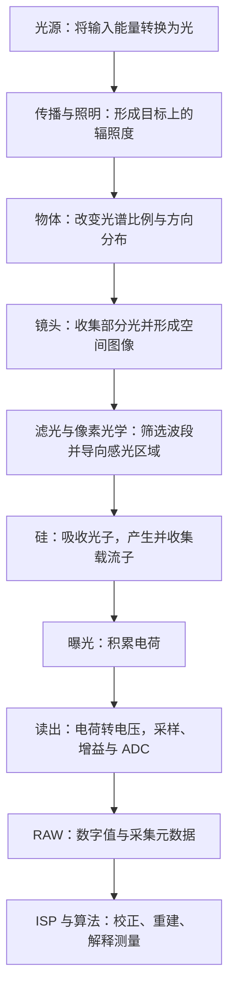

# 一个光子的旅行

> 沿着光源、物体、镜头、硅和读出电路，理解场景如何成为 RAW 图像。

本篇以“一个光子的旅行”为线索，逐步展开讲解光怎样产生，物体怎样改变出射光的光谱与方向，镜头怎样收集光并形成空间图像，硅又怎样吸收光能并留下可收集的电荷。这里的“旅行”帮助我们串联各个环节，并不意味着光子具有一条可以始终追踪的经典轨迹。光子一旦被吸收，这次光的传播便在此结束；后续追踪的对象转为电荷、电压和数字值，它们保留了这次相互作用带来的测量信息。实际曝光中，大量光子共同参与测量，普通成像像素积累的是成功产生并收集到的电荷，读出结果还包含探测与电路引入的统计波动。

本篇先保持旅行路线连续，回答每一步的输入、作用和输出。概念详解、推导、读图方法、计算例子与实验整理在[《一个光子的旅行：附文》](01_一个光子的旅行_附.md)。

## 阅读索引

| 层次 | 阅读目标与入口 |
| --- | --- |
| 主文 | 沿下文的旅行路线理解场景怎样成为 RAW |
| 附文 | [概念、推导与实验](01_一个光子的旅行_附.md#主题索引)，以及[噪声概览](01_一个光子的旅行_附.md#noise-overview)、[有效分辨率概览](01_一个光子的旅行_附.md#resolution-overview)、[光子预算示例](01_一个光子的旅行_附.md#budget-overview) |
| 附文附件 | [附件 01：近红外成像与室温热成像](01_一个光子的旅行_附_附件01.md#阅读层次与索引) |

## 1. 先建立整条链路



这条链路包含三个核心转变：光携带场景信息，光与硅的相互作用形成电荷，电荷被编码为数字值。每一步都可能限制最后得到的信息。

沿着这条链路，我们将依次追问：光怎样产生并到达物体？物体返回的光怎样被镜头收集并形成图像？到达硅的光怎样留下电荷，又怎样成为 RAW 数字值？这些问题构成主文的旅行路线；各环节对图像亮度、颜色、细节和噪声的影响，可在附文中继续展开。

阅读中涉及的光学模型与基本概念，可按需查阅[附文 A1：光的模型与基本概念](01_一个光子的旅行_附.md#models)。

## 2. 第一站：光源把能量转换为光

要理解光源怎样把能量转换为光，要分别回答三个问题：**能量从哪里来？材料通过什么过程把能量释放为光？最终离开光源的光具有怎样的波长、方向和时间分布？**

### 2.1 输入的能量有哪些？

下面按光源直接接受的输入分类。若继续向上游追溯，电能还可以来自其他形式的能量转换；一个光源内部也可能连续经历多种转换。

| 直接输入的能量 | 能量怎样进入发光系统 | 例子与后续路径 |
| --- | --- | --- |
| 电能 | 电场对载流子做功，注入载流子、加速电子或产生电阻加热 | LED 的载流子复合、气体放电灯的碰撞激发、白炽灯的灯丝加热、半导体激光器的电泵浦 |
| 加热输入 / 已有热内能 | 材料因加热或已有温度而具有热激发，持续发出电磁辐射 | 加热的金属、灯丝以及常温物体的热辐射；波段取决于温度与材料 |
| 化学能 | 化学反应释放能量，形成激发态，或先使材料升温 | 荧光棒的化学发光；火焰还可同时包含高温颗粒热辐射与激发物种的发射 |
| 入射光能 | 材料吸收激发光，进入激发态，再释放部分能量 | 荧光粉、荧光标记、光泵浦激光器 |
| 机械能 | 某些材料受压、摩擦或断裂时产生电荷分离或其他激发过程 | 特定材料的机械致发光；不是所有摩擦或变形都会产生可见光 |

电能和入射光能描述能量经电路或光照传入；化学能储存在反应物中，由反应释放；机械能通过力与运动输入。加热则要区分能量传递与能量储存：热是因温差而传递的能量，热内能是物体内部与温度有关的能量。物体发出热辐射时消耗内能，持续加热可以补充这部分能量。

这些能量名称说明的是“能量怎样送进来”。它们不直接决定输出是什么颜色，更不意味着电能只能生成 LED 光、热能只能生成红外光。输出还取决于材料能态、温度、激发方式与光学结构。化学发光的定义可参考 [IUPAC](https://goldbook.iupac.org/terms/view/C01045)，机械作用与发光的具体案例见 [ACS 的摩擦发光研究](https://pubs.acs.org/doi/abs/10.1021/la302689y)。

### 2.2 能量通过哪些方式成为光？

在许多非热发光过程中，输入能量先把原子、分子或半导体中的载流子系统激发到较高能态。“激发态”表示系统比原来的低能状态储存了更多能量；发生合适的辐射跃迁时，能量以光子形式释放。也存在不发光的能量释放路径，例如把能量传给晶格并转为热。热辐射则需要用温度与光谱分布描述，不能把所有光源都简化为孤立原子的两条能级。

可以先把常见路径画成下面的关系，再逐一理解中间的过程：

```text
电能 → 注入电子与空穴 → 辐射复合 → LED 光
电能 → 加速电子 → 碰撞激发原子或分子 → 放电发光
电能 / 化学能等 → 材料升温 → 热辐射
入射光能 → 吸收与激发 → 弛豫与重新发射 → 荧光
化学能 → 反应产生激发态 → 辐射跃迁 → 化学发光
电能 / 入射光能等 → 泵浦增益介质 → 受激辐射与反馈 → 激光输出
```

**LED：通过载流子复合发光。** 电压驱动电流，使电子和空穴进入半导体的发光区域；它们发生辐射复合时，部分能量以光子形式释放。发射波段与半导体能带和器件结构有关，所以不同材料与结构可以制成紫外、可见光或近红外 LED。也存在不发光的复合过程，它们会降低转换效率并产生热。参见 [美国能源部：LED 的复合与效率](https://www.energy.gov/science/bes/articles/led-lighting-may-now-shine-brighter)。

**放电灯：通过碰撞激发发光。** 电场加速的电子与气体原子或分子碰撞，把能量传给它们；激发态随后发生辐射跃迁，输出由这些物种能态决定的光。气体种类、压力和工作条件会影响谱线、谱带及其展宽。荧光灯还增加了一步：放电产生的紫外光被荧光粉吸收，再转换为可见光。相关路径见[美国能源部：灯泡与放电照明](https://www.energy.gov/articles/history-light-bulb)。

**热辐射：先形成热内能，再持续辐射。** 白炽灯中，电能先通过电阻加热使灯丝升温，灯丝再发出热辐射。这里的光谱由温度和光谱发射率共同决定，通常覆盖较宽波长范围，不能简化为一个孤立跃迁对应一种颜色。室温下的主要热辐射位于长波红外；温度升高后，可见光中的辐射增强，物体逐渐呈现红热、白热。室温下为何普通硅相机不能直接看见温度分布，见[附件 01](01_一个光子的旅行_附_附件01.md#room-temperature)；连续热辐射谱可参考 [NASA 的黑体谱说明](https://science.nasa.gov/asset/webb/continuous-spectra-blackbody-curves-of-stars/)。

**荧光：吸收光能后重新发射。** 材料吸收激发光后进入激发态，部分能量经非辐射弛豫转为热，再以新的光子释放剩余能量。常见 Stokes 荧光的发射波长比激发光更长；原来的光子已经被吸收，后面的光子属于新的发射事件。白光 LED 常用蓝光 LED 激发荧光粉，把剩余蓝光与转换后的较长波长光混合成白光；也可用多种颜色 LED 混光。因此白光不是一种单独波长。白光实现方式见 [美国能源部：LED Basics](https://www.energy.gov/cmei/ssl/led-basics)。

**化学发光：反应直接提供激发能量。** 化学反应可以让产物进入激发态，或把能量转移给发光分子；随后发生辐射跃迁。它可以在不把整个材料加热到红热的条件下产生可见光，荧光棒就是常见例子。火焰则可能同时包含化学过程、碰撞激发以及炽热颗粒的热辐射，不能统一解释为一种机制。化学能转成可见光的示例见 [ACS：Chemistry That Glows](https://www.acs.org/education/activities/chemistry-that-glows.html)。

**激光：泵浦储能，再通过受激辐射输出。** 电注入、放电或另一束光先把能量送入增益介质，建立能够提供光学增益的状态。与相应跃迁匹配的光可触发受激辐射；常见激光振荡器利用光学反馈，使特定模式反复放大，并耦合出一部分光。输出能量来自泵浦输入，触发受激辐射的光子并不是凭空提供额外能量。很多激光器具有较强方向性、相干性与较窄光谱，但具体线宽、模式和脉冲性质取决于设计，不能把所有激光都视为理想单色光。参见 [Coherent：激光的泵浦、增益与反馈](https://www.coherent.com/news/glossary/laser)。

因此，同样是“电能变成光”，LED、白炽灯与激光器经过的中间过程不同；同样采用荧光转换，激发光也可以来自 LED 或气体放电。**能量来源与发光机制是相互关联、但并不一一对应的两个层面。**

### 2.3 不同方式输出的光，有哪些区别？

光源名称只能帮助判断大致特点。成像真正使用的是离开光源后的光，因此还需要比较下面这些量：

| 输出特性 | 具体在比较什么 | 为什么影响成像 |
| --- | --- | --- |
| 波段与光谱形状 | 紫外、可见或红外；连续谱、谱线、谱带及宽度 | 决定哪些材料能被有效照明、哪些波段能经过光学系统并被传感器响应 |
| 辐射功率与光子数量 | 单位时间输出多少光能、对应多少光子 | 决定可用信号量；相同光功率下，不同波长的光子流率不同 |
| 方向与空间分布 | 光向哪些方向发出，发光面积与各处亮度如何 | 决定光能否集中到目标、照明均匀性及镜头实际收到多少光 |
| 相干性 | 光场在空间与时间上的相位关联 | 强相干照明可能产生明显干涉或散斑；不能只用颜色描述 |
| 偏振 | 电磁场的偏振状态 | 影响材料反射、偏振滤光和反光抑制 |
| 时间特性 | 连续、脉冲、频闪、PWM 与漂移 | 决定曝光窗口实际积累多少光，并可能与 rolling shutter 相互作用 |

典型热辐射源具有宽的连续谱；单色 LED 通常集中在一个具有有限宽度的谱带；放电源可能具有突出的谱线或谱带；荧光输出由发光材料的吸收与发射特性决定；很多激光器的输出更集中于特定光学模式。这些是常见趋势，具体仍应查看光谱和工作条件。

同样标称“白光”，热辐射白光、荧光粉转换白光与 RGB 混合白光可以具有不同光谱。同样标称“红光”，LED 与激光也可能具有不同的光谱宽度、角分布和相干性。照到同一物体、经过同一相机后，它们不一定产生相同颜色、对比度或噪声表现。

### 2.4 为什么输入功率不等于有用的出射光量？

输入能量并不全部成为有用的出射光，非辐射过程、热和器件内部损失都会参与。对某个光源，应依次区分：送入器件的能量、内部生成的辐射、实际离开器件的辐射，以及落在任务所需波段中的辐射。产生的光还可能在内部被吸收、被反射回去，或因封装与出光结构而无法有效射出；这些过程会改变效率和出射分布。

能量描述一段过程总共转移了多少，常用 J；功率描述转移的速率，常用 W，即 J/s。灯具的电功率是输入端的速率，光源的辐射功率是出射光的速率，两者之间需要转换效率。对于脉冲照明，还要区分单脉冲能量、峰值功率和平均功率；相同平均功率不保证在一次曝光中收到相同能量。

即使两个光源输出的总辐射功率相同，任务波段占比、方向、照明位置和时间波形也可能不同。光从光源到目标还存在传播与照明光学的影响，所以灯的电功率不能直接代表目标收到的光量。下一站将继续追踪这部分出射光怎样形成目标上的照明。

### 2.5 输入能量与单个光子能量有什么关系？

电能、化学能、热内能或激发光能说明能量的来源；单个输出光子的能量则由它的频率决定。来源不同、但频率相同的光子具有相同的单光子能量，不能根据一个光子的能量判断它来自 LED、热辐射还是激光。材料的能态、温度与光学模式选择，决定输入能量最终被分配到哪些输出波长；输入的总能量还决定可提供的光量规模。

对频率为 ν、真空波长为 λ₀ 的光：

$$
E_\gamma=h\nu=\frac{hc}{\lambda_0}.
$$

ν 是频率，λ₀ 是真空波长，h 是普朗克常数，c 是真空光速。波长越短，单个光子能量越高；在相同辐射功率下，光子数量却可能更少。因此“更高光子能量”“更多光子”和“图像更亮”是不同问题。

光源光谱描述各波长上分配了多少能量。同样色温的白光也可能有不同光谱，后面经过材料和相机响应后，得到不同颜色和缺陷对比度。

这一站的输出是具有特定光谱、方向和时间分布的光。详见[附文 A2：光源与光谱](01_一个光子的旅行_附.md#sources)、[A3：光子能量与光子流率](01_一个光子的旅行_附.md#energy)。

## 3. 第二站：光传播到目标，形成照明

光源发出的光只有一部分到达目标。距离、方向、发光面积、照明光学和遮挡，共同决定目标各处接收到的光。

这里最直接的量是辐照度，即单位面积接收到的辐射功率，常用 W/m²。若还要描述波长组成，就使用光谱辐照度。它与按人眼敏感度加权的 lux 不是同一个量；相同 lux 不保证相同光子输入或相同相机信号。

光的时间分布也重要。相机积分的是有效曝光窗口中的光；频闪、PWM 或照明漂移会改变不同曝光收到的能量。Rolling shutter 不同行的窗口存在时间偏移，还可能形成亮暗条带。

这一站的输出是目标表面随位置、波长和时间变化的辐照度。它仍不是传感器像面上的辐照度，中间还要经过物体和镜头。详见[附文 A4：辐射度量与光子预算](01_一个光子的旅行_附.md#radiometry)。

## 4. 第三站：物体改变光的光谱比例与传播方向

光到达材料后，可以被反射、透射或吸收，也可能在表面和内部发生散射。反射或透射的光把材料、表面和几何结构的信息带向相机。

常规弹性反射通常保留光的频率，但不同波长被不同程度地返回，改变了出射光谱的比例。红色材料在白光下返回较多红光，不代表它能把任意蓝光光子直接“染成红色”。荧光则属于吸收后重新发射的过程，需要另外考虑波长转换。

方向也会变化。镜面反射可能集中在很窄的方向范围；粗糙表面和体散射可能让光分布到更多方向。总反射率较高，不保证朝镜头方向很亮。工业照明利用这些方向差异，让划伤、边缘或材料变化相对背景显现。

对理想 Lambertian 漫反射、无自发光和波长转换的表面：

$$
L_{\mathrm{object},\lambda}
=\frac{\rho(\lambda)E_{\mathrm{object},\lambda}}{\pi}.
$$

ρ(λ) 是光谱反射率，E<sub>object,λ</sub> 是目标上的光谱辐照度，L<sub>object,λ</sub> 是出射光谱辐亮度。真实材料还可能具有方向相关响应，需要更完整的反射模型。

这一站的输出是从场景不同位置、向不同方向传播的光谱辐亮度。详见[附文 A5：物体的光谱与方向响应](01_一个光子的旅行_附.md#scene)。

## 5. 第四站：镜头收集部分光，把场景映射到像面

镜头入瞳只占目标返回光的一部分方向范围，因此不会收集全部光。进入镜头的光还会受到反射、吸收、遮挡和透过率的影响。

镜头同时完成空间成像：来自同一物点的不同方向光在像面附近形成对应分布，不同物点对应不同位置。焦距、物距、像距和传感器尺寸决定成像几何；工作距离、对焦位置与实际镜头结构需要明确区分。

物点不会形成无限小的像点。衍射、像差和离焦决定 PSF；MTF 则描述不同空间频率的对比度能被保留多少。高像素数不能保证镜头已经传递了相应的细节。

光圈影响收光和空间质量。开大通常增加采光，但可能暴露更强像差；适度收小可能改善像差并增加景深；收得过小，衍射会使光斑展宽并降低高频对比度。

对轴上、空气中、近轴、无渐晕且适合使用 working F-number 的简化模型：

$$
E_{\mathrm{image},\lambda}
\approx\tau_{\mathrm{lens}}(\lambda)
L_{\mathrm{object},\lambda}\frac{\pi}{4N_{\mathrm{work}}^2}.
$$

τ<sub>lens</sub>(λ) 是镜头光谱透过率，N<sub>work</sub> 描述当前成像条件的有效光锥。离轴、有限倍率和真实镜头设计需要相应修正。

这一站的输出是像面上的空间光分布与光谱辐照度。详见[附文 A6：镜头、衍射、PSF 与 MTF](01_一个光子的旅行_附.md#optics)。

## 6. 第五站：滤光与像素光学筛选进入硅的光

光在进入感光硅之前，可能经过保护玻璃、IR-cut、窄带滤镜、偏振片、微透镜和 CFA。具体结构与顺序取决于设计。

滤镜选择波段或偏振，也会损失部分光量。微透镜把光更有效地导向感光区域；Bayer CFA 让不同位置测量不同的光谱通道。每个 Bayer 像素仍只输出一个通道的标量信号，缺少的颜色信息由后续重建估计。

IR 污染需要按任务定义：若目标是可见光颜色测量，非目标近红外进入硅并贡献电荷，就可能改变颜色、材料对比度、曝光统计或焦点表现。若任务本来就是近红外检测，这些光可以是有用信号。

R/G/B 通道可能同时受到近红外影响。它们积累的电荷没有保留波长标签，白平衡不能普遍分离未知的可见光与近红外贡献；必要时应从光谱和光学滤波控制输入。

这一站的输出是经过像素光学结构筛选、到达感光区域的光。计算时必须选定参考面：如果外部 QE 已包含这些损失，就不能再次乘同一项透过率。详见[附文 A7：滤光、Bayer 与 IR 污染](01_一个光子的旅行_附.md#filters)。

普通相机能否拍红外，以及近红外为什么不等于室温热成像，见[附文附件 01](01_一个光子的旅行_附_附件01.md#room-temperature)。

## 7. 第六站：硅吸收光子，产生并收集载流子

光子在硅中被有效吸收后，可以将价带电子激发到导带，留下一个空穴，形成电子空穴对。电子不是凭空出现，而是已有电子的能态发生改变；空穴是电子缺位所表现出的有效载流子。

普通可见光、无内部倍增的模型中，一次成功的有效吸收通常产生一对电子空穴。较高单光子能量不意味着必然得到更多信号电子，剩余能量主要经过弛豫转为热。

产生载流子还不等于得到信号。电场帮助分离与输运，弱场区域还可能通过扩散参与收集；部分载流子在到达有效区域前复合或被捕获。吸收深度、厚度、场分布和复合共同影响响应。

指定波长和参考面的有效量子效率为：

$$
\eta(\lambda)=\frac{\mu_e}{\mu_\gamma},
\qquad
\mu_e=\eta(\lambda)\mu_\gamma.
$$

η(λ) 是有效 QE，μₑ 是期望信号电子数，μ<sub>γ</sub> 是期望入射光子数。它们描述平均转换关系，不表示每次曝光都严格按固定比例得到整数电子数。

这一站的输出是能够贡献像素信号的载流子。光子被吸收后的旅行在这里结束，后面追踪的是电荷及其读出。详见[附文 A8：硅吸收、载流子与量子效率](01_一个光子的旅行_附.md#silicon)。

## 8. 第七站：曝光积累电荷，读出成为 RAW

曝光期间，像素积累光生电荷，也可能积累暗电流相关电荷。电荷容量有限；光电二极管、读出节点、模拟链路或 ADC 都可能先达到饱和边界。

以常见 4T PPD CMOS 像素为例，电荷在光电二极管中积分，读出时转移到 FD。电荷改变节点电压，经采样、CDS、增益与 ADC 形成数字值。架构不同，时序与实现会变化。

$$
|Q|=N_e q,
\qquad
|\Delta V|\approx\frac{N_e q}{C_{\mathrm{FD}}}.
$$

Nₑ 是电子数，q 是基本电荷量，C<sub>FD</sub> 是有效节点电容。电荷转电压的大小、后级增益与量化步长共同决定每个电子对应多少 DN。

在固定配置、扣清参考并处于近似线性区时，平均输出可以简化为：

$$
\overline{\mathrm{DN}}\approx B+K\mu_e.
$$

B 是黑电平，K 是 DN/e⁻ 单位的有效增益；这里暂不计暗电流平均值和额外噪声。RAW12 理论编码为 0–4095，但实际黑白电平、有效位深和存储布局必须查配置。

RAW 不一定完全没有经过处理。理解它还需要曝光、增益、CFA、尺寸、stride、packed 位序以及内部校正等元数据。错误解码 buffer 会产生假条纹、假颜色或亮度异常。

这一站的输出是数字测量和采集元数据。详见[附文 A9：电荷读出、ADC 与 RAW](01_一个光子的旅行_附.md#readout)。

## 9. 第八站：从 RAW 走向 ISP

RAW 是传感器对输入光的测量结果。ISP 在此基础上校正偏置与不均匀性、重建缺失通道、抑制噪声并映射颜色和显示范围；计算摄影和 AI 还可利用多次测量与先验。后续算法的可靠性仍受输入条件约束。

遇到异常时，沿旅行路线检查：先确认照明和材料返回光，再确认光学与滤镜，然后检查传感器配置、RAW 解码及处理。每次尽量只改变一个主要条件，用结果区分假设。

| 验证目标 | 优先控制和观察 |
| --- | --- |
| 光源与光谱 | 预热、驱动、频闪、目标辐照度及滤镜配置 |
| 物体与光学 | 照明方向、波长、焦点、光圈与视场位置 |
| 光电转换与 RAW | 暗场、多帧线性响应、增益、黑白电平与存储布局 |
| 细节可靠性 | 空间响应、采样、运动、真实光量与检测或测量误差 |

实验步骤见[附文 A13：十个验证实验](01_一个光子的旅行_附.md#experiments)，后续模块见[附文 A14：ISP 学习路径](01_一个光子的旅行_附.md#next)。物理与测量参考资料集中在[附文末尾](01_一个光子的旅行_附.md#参考资料)。

从光的产生、传播和筛选，到光电转换与数字读出的链路至此闭合：理解每一步怎样贡献或损失信息，是继续学习 RAW、ISP、计算摄影和 AI ISP 的基础。
